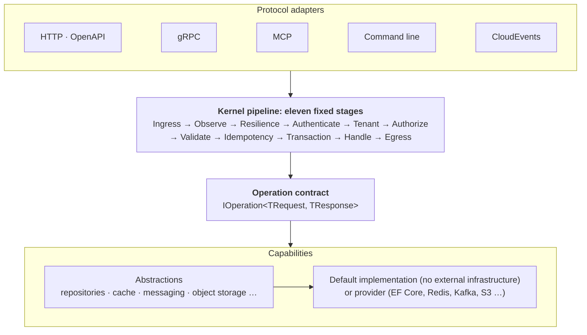

<div align="center">


<h3>One operation contract, served over HTTP, gRPC, MCP and the command line</h3>

<p>Compose what you need · No external infrastructure by default · Reflection-free kernel, Native AOT · Plugins in any language</p>

<p>
  <a href="https://github.com/XiHanFun/XiHan.Framework/actions/workflows/ci.yml"></a>
  <a href="https://www.nuget.org/packages?q=XiHan.Framework"></a>
  
  <a href="./LICENSE"></a>
  <a href="https://github.com/XiHanFun/XiHan.Framework/stargazers"></a>
  <a href="https://gitee.com/XiHanFun/XiHan.Framework"></a>
  <a href="https://gitcode.com/XiHanFun/XiHan.Framework"></a>
</p>

<p>
  <a href="https://framework.docs.xihanfun.com"><b>Docs</b></a> ·
  <a href="#getting-started"><b>Getting Started</b></a> ·
  <a href="#samples"><b>Samples</b></a> ·
  <a href="https://framework.docs.xihanfun.com/packages/"><b>Packages</b></a> ·
  <a href="https://github.com/XiHanFun/framework-spec"><b>Specification</b></a> ·
  <a href="https://framework.docs.xihanfun.com/changelog"><b>Changelog</b></a>
</p>

<p><b>English</b> | <a href="./README_cn.md">简体中文</a></p>

</div>

XiHan.Framework is a .NET framework for backends that have to be maintained for years. It is built around a microkernel, a capability graph and an execution pipeline. Business logic is written as protocol-agnostic operations, protocol adapters expose them, and every invocation runs through the same pipeline. Persistence, caching, messaging, tenancy and permissions are replaceable packages: development needs no external infrastructure, and going to production means switching providers without touching business code.

It is also the .NET reference implementation of [XiHan Spec](https://github.com/XiHanFun/framework-spec), a language-neutral specification that other languages implement against the same conformance vectors.

## One contract, many protocols

Write the business logic once. This operation, excerpted from [SimpleApp](./framework/samples/SimpleApp/Orders/CreateOrder.cs), declares the protocols it is exposed on and the permission it requires:

```csharp
[Operation("orders.create", Stability = Stability.Experimental,
    Expose = Expose.Http | Expose.Grpc | Expose.Mcp, Permission = "orders.write")]
public sealed class CreateOrder(IRepository<Order, Guid> orders, IIdGenerator<Guid> ids, TimeProvider clock)
    : IOperation<PlaceOrderRequest, OrderResponse>
{
    public async ValueTask<Result<OrderResponse>> HandleAsync(PlaceOrderRequest request, InvocationContext context)
    {
        var order = new Order { Id = ids.NewId(), Name = request.Name, Amount = request.Amount };
        order.Place(clock.GetUtcNow());

        var added = await orders.AddAsync(order, context.CancellationToken);
        return added.IsFailure ? added.Error! : new OrderResponse(order.Id, order.Name, order.Amount, order.CreatedAt);
    }
}
```

A source generator produces the registration code and JSON Schema, and every protocol entry point is derived from this one contract:

| Protocol | Entry point | What you also get |
| --- | --- | --- |
| HTTP | `POST /orders` | OpenAPI 3.1 (`/openapi.json`), RFC 9457 Problem Details |
| gRPC | `Orders/Create` | A `.proto` file (`/operations.proto`), with the protobuf wire format derived from the schema |
| MCP | tool `orders_create` | Description and input schema in `tools/list`, over Streamable HTTP and stdio |
| Command line | `greetings create --name Ada` ([SimpleCli](./framework/samples/SimpleCli)) | Exit codes by error kind, Problem JSON on stderr when it fails |
| AI tools | `Expose.Ai` | A model tool that runs through the full pipeline |

Authentication, tenancy, authorization, validation, idempotency and transactions all live in the pipeline, so switching protocols cannot skip them. The same principal without the `orders.write` permission gets the same error code over HTTP and MCP:

```text
$ curl -i -X POST localhost:5000/orders -H "Authorization: ApiKey dev-bob-key" \
    -H "Content-Type: application/json" -d '{"name":"x","amount":1}'
HTTP/1.1 403 Forbidden
{"type":"urn:xihan:error:SECURITY_DENIED_004","status":403,"detail":"Permission 'orders.write' is missing.",…}

$ curl -X POST localhost:5000/mcp -H "Authorization: ApiKey dev-bob-key" -H "Content-Type: application/json" \
    -d '{"jsonrpc":"2.0","id":2,"method":"tools/call","params":{"name":"orders_create","arguments":{"name":"x","amount":1}}}'
{"jsonrpc":"2.0","id":2,"result":{"content":[{"type":"text","text":"SECURITY_DENIED_004: Permission 'orders.write' is missing."}],"isError":true}}
```

## Highlights

- **Composition errors surface before startup**: every feature carries a manifest that declares what it provides and requires by capability ID. The kernel resolves the capability graph before starting, and missing dependencies, cycles, version conflicts and ambiguous candidates all fail right away, for example `'xihan.hello.greetings' requires 'caching.distributed@1', but no manifest provides it.` The resolved graph is printed to the log. [Features and manifests](https://framework.docs.xihanfun.com/guide/modularity)
- **Cross-cutting logic has a fixed place**: each invocation passes through eleven fixed stages. Middleware only cares about its own stage, and the order is deterministic, printable and testable, with no dynamic proxies. [Pipeline](https://framework.docs.xihanfun.com/guide/pipeline)
- **No dependencies in development, providers in production**: every abstraction has a bounded default implementation, so an application runs without a database or Redis. In production, add a package and one `UseFeature` line and the default steps aside. Providers and defaults pass the same conformance suite. [Packages](https://framework.docs.xihanfun.com/packages/)
- **No reflection, ready for Native AOT**: the primitives and the kernel use no runtime reflection, registration and schemas are generated at compile time, and CI runs an AOT publish smoke test on every build. Providers that do not support AOT say so on their package page. [Serialization and Native AOT](https://framework.docs.xihanfun.com/guide/aot)
- **Plugins do not have to be trusted**: three isolation levels, in-process, Wasm and out-of-process. Out-of-process plugins speak a gRPC protocol and can be written in any language (a Go SDK is available). A crash degrades the application and triggers a backoff restart, and never takes the host down. [Plugins](https://framework.docs.xihanfun.com/guide/plugins)
- **Built for AI tooling**: operations become MCP tools and model tools directly, and `xihan mcp` gives coding assistants an offline knowledge base of the framework's packages, configuration keys and documentation. [MCP server](https://framework.docs.xihanfun.com/ai/mcp)
- **Boundaries are enforced by machines**: dependency direction, naming grammar, zero reflection, third-party type leaks and public API baselines are checked by analyzers and architecture tests, not by reviewers' memory. See [Quality and stability](#quality-and-stability).

## Getting Started

You need the [.NET 10 SDK](https://dotnet.microsoft.com/download). Create a project and add three packages:

```bash
dotnet new web -n HelloXiHan
cd HelloXiHan
dotnet add package XiHan.Framework.Profiles.Minimal --prerelease
dotnet add package XiHan.Framework.Protocols.Http --prerelease
dotnet add package XiHan.Framework.Kernel.Generators --prerelease
```

Replace `Program.cs` with the following. The entry point, the operation and the feature all live here:

```csharp
using System.Text.Json.Serialization;
using HelloXiHan; // The generated AddGeneratedOperations lives in the project's root namespace
using XiHan.Framework.Hosting.AspNetCore;
using XiHan.Framework.Kernel;
using XiHan.Framework.Kernel.Hosting;
using XiHan.Framework.Kernel.Operations;
using XiHan.Framework.Primitives;
using XiHan.Framework.Primitives.Manifests;
using XiHan.Framework.Profiles.Minimal;
using XiHan.Framework.Protocols.Http;
using XiHan.Framework.Protocols.Http.Routing;

var builder = WebApplication.CreateBuilder(args);

// Hand the features to the kernel: it resolves the capability graph and calls each Configure in topological order
builder.AddXiHan(xihan => xihan
    .UseMinimalProfile()
    .UseFeature<HttpProtocolFeature>()
    .UseFeature<GreetingsFeature>());

var app = builder.Build();

app.UseXiHan();            // HTTP requests enter the kernel pipeline
app.MapXiHanHealth();      // /health/startup, /health/ready, /health/live
app.MapXiHanOperations();  // Map routes from the operation registry

app.Run();

// Operation: the resource of greetings.create is greetings and the verb is create, so HTTP derives POST /greetings
[Operation("greetings.create", Stability = Stability.Experimental, Expose = Expose.Http)]
public sealed class Greet : IOperation<GreetRequest, GreetResponse>
{
    public ValueTask<Result<GreetResponse>> HandleAsync(GreetRequest request, InvocationContext context)
        => ValueTask.FromResult(Result.Success(new GreetResponse($"Hello, {request.Name}!")));
}

public sealed record GreetRequest(string Name);

public sealed record GreetResponse(string Message);

// The kernel does not serialize through reflection, so request and response types go in a source-generated context
[JsonSourceGenerationOptions(
    PropertyNamingPolicy = JsonKnownNamingPolicy.CamelCase,
    PropertyNameCaseInsensitive = true)]
[JsonSerializable(typeof(GreetRequest))]
[JsonSerializable(typeof(GreetResponse))]
internal sealed partial class AppJsonContext : JsonSerializerContext;

// Feature: the manifest requires the kernel's hosting capability, and Configure registers the generated operations
public sealed class GreetingsFeature : IFeature
{
    public Manifest Manifest { get; } = new()
    {
        Id = "xihan.hello.greetings",
        Package = "HelloXiHan",
        Version = "1.0.0",
        Primitives = 1,
        Stability = Stability.Experimental,
        Kind = ManifestKind.Capability,
        Requires = [new CapabilityRequirement(KernelCapabilities.Hosting, KernelCapabilities.Version)],
        Entry = typeof(GreetingsFeature).FullName,
    };

    public void Configure(FeatureContext context) => context.AddGeneratedOperations();
}
```

Run it and call it:

```bash
dotnet run --urls http://localhost:5000
```

```bash
curl -X POST http://localhost:5000/greetings -H "Content-Type: application/json" -d '{"name":"Ada"}'
```

```json
{"message":"Hello, Ada!"}
```

<details>
<summary>The startup log prints the capability graph and the pipeline order</summary>

```text
Capability graph:
xihan.kernel.core <version>
  provides kernel.hosting@1
  ...
xihan.localization.inmemory <version> (default)
  provides localization.resources@1
  requires kernel.hosting@1 -> xihan.kernel.core
xihan.protocols.http <version>
  provides protocols.http@1
  requires kernel.hosting@1 -> xihan.kernel.core
xihan.hello.greetings 1.0.0
  requires kernel.hosting@1 -> xihan.kernel.core

Pipeline:
observe      XiHan.Framework.Kernel.Diagnostics.ObserveMiddleware
resilience   XiHan.Framework.Kernel.Pipeline.DeadlineMiddleware
resilience   XiHan.Framework.Kernel.Resilience.ResilienceMiddleware
validate     XiHan.Framework.Kernel.Validation.ValidationMiddleware
```

</details>

<details>
<summary>A request that breaks the contract gets Problem Details, translated by Accept-Language</summary>

```bash
curl -i -X POST http://localhost:5000/greetings -H "Content-Type: application/json" -d '{}'
```

```text
HTTP/1.1 400 Bad Request
Content-Type: application/problem+json
Content-Language: en-US

{"type":"urn:xihan:error:KERNEL_VALIDATION_003","title":"VALIDATION","status":400,
 "detail":"The request of operation 'greetings.create' does not match its contract: $.name: required property 'name' is missing",
 "instance":"/greetings","code":"KERNEL_VALIDATION_003","traceId":"…",
 "errors":{"name":["required property 'name' is missing"]},
 "details":{"id":"greetings.create","reason":"$.name: required property 'name' is missing"}}
```

</details>

Next, the [quickstart](https://framework.docs.xihanfun.com/quickstart) switches to the Standard profile, where authentication, tenancy, authorization, idempotency and transactions appear in the pipeline.

## Architecture



The framework makes three tiers of promise, named after the three meanings of change in the I Ching: the unchanging (不易), the simple (简易) and the changing (变易). Only a very small layer is frozen and everything else can be replaced. Dependencies only point to lower rings, enforced by architecture tests.

| Promise | Ring | Contents |
| --- | --- | --- |
| **Unchanging**: never breaks, only grows | Ring 0 | `Primitives`: `Result`, `Error`, invocation context, manifest model, pipeline stages |
| **Simple**: no breaking changes within a major version | Ring 1 | `Kernel`: hosting, capability graph, pipeline, operation contracts, diagnostics, security primitives |
| **Changing**: evolves freely, compatible once it passes the conformance suite | Ring 2–6 | Abstractions, default implementations and providers, hosts, protocols and plugins, profiles |

The reasoning is in the [overall design](./design/框架总体方案.md) and the [design philosophy](./design/architecture/02-框架设计哲学.md) (both in Chinese).

## What's in the box

| Capability | Default (no external infrastructure) | Providers |
| --- | --- | --- |
| [Persistence](https://framework.docs.xihanfun.com/guide/persistence) | In-memory | EF Core, SqlSugar |
| [Caching and distributed locks](https://framework.docs.xihanfun.com/guide/caching) | In-memory | Redis, two-level cache, remote plugin |
| [Messaging and events](https://framework.docs.xihanfun.com/guide/messaging) | In-memory, with outbox | RabbitMQ, Kafka, CloudEvents webhook |
| [Multi-tenancy](https://framework.docs.xihanfun.com/guide/multi-tenancy) | In-memory | Database, with per-tenant databases |
| [Authentication](https://framework.docs.xihanfun.com/guide/authentication) and [authorization](https://framework.docs.xihanfun.com/guide/authorization) | In-memory (API key, RBAC) | JWT, OpenID Connect, database grants |
| [Scheduling](https://framework.docs.xihanfun.com/guide/scheduling) | In-memory | Database (clustered dispatch), Kubernetes (leader election) |
| [Workflow](https://framework.docs.xihanfun.com/guide/workflow) | In-memory | Database |
| [Object storage](https://framework.docs.xihanfun.com/guide/storage) | File system | S3 and compatible services (MinIO, OSS, COS, R2) |
| [Auditing](https://framework.docs.xihanfun.com/guide/auditing) | In-memory | Database |
| [Localization](https://framework.docs.xihanfun.com/guide/localization) | In-memory (10 built-in locales) | Database |
| [Configuration](https://framework.docs.xihanfun.com/guide/configuration) | .NET configuration | Nacos |
| [Observability](https://framework.docs.xihanfun.com/guide/observability) | `System.Diagnostics` | OpenTelemetry |
| [AI](https://framework.docs.xihanfun.com/guide/ai) | Tool bridge (`Expose.Ai`) | OpenAI-compatible endpoints, `Microsoft.Extensions.VectorData` |

If you would rather not pick packages one by one, use a profile:

| Profile | Contents | Good for |
| --- | --- | --- |
| `XiHan.Framework.Profiles.Minimal` | Primitives, kernel, ASP.NET Core host, in-memory localization | Edge services, tools, plugin hosts |
| `XiHan.Framework.Profiles.Standard` | Minimal, plus the domain model and the abstractions and defaults of five subsystems | Most business services |
| `XiHan.Framework.Profiles.Full` | Standard, plus object storage, scheduling, auditing, workflow, the AI tool bridge, OpenTelemetry and four protocol adapters | Admin systems, SaaS |

Every package is listed in the [package overview](https://framework.docs.xihanfun.com/packages/) and the [framework engineering notes](./framework/README.md#正式包).

## Samples

None of them need external infrastructure. Clone and run:

```bash
git clone --recurse-submodules --branch dev https://github.com/XiHanFun/XiHan.Framework.git
cd XiHan.Framework
dotnet run --project framework/samples/SimpleApp
```

```bash
curl -X POST localhost:5000/orders -H "Authorization: ApiKey dev-alice-key" \
  -H "Content-Type: application/json" -d '{"name":"widget","amount":3}'
```

| Sample | Contents |
| --- | --- |
| [SimpleApp](./framework/samples/SimpleApp) | Standard profile: one order contract over HTTP, gRPC and MCP, inbound CloudEvents handed to a message handler, with tenancy, API key authentication, permissions, transactions, domain events and an outbox. Also the Native AOT smoke test |
| [SimpleCli](./framework/samples/SimpleCli) | Minimal profile: one contract as a command-line command and an MCP stdio tool |
| [KubernetesApp](./framework/samples/KubernetesApp) | Full profile: probes, graceful shutdown, ConfigMap hot reload, Lease leader election and deployment artifacts generated by `xihan pack` |
| [Plugin samples](./framework/samples) | `SamplePlugin` (in-process), `EchoPlugin` (out-of-process .NET), `EchoWasmPlugin` (Wasm in Rust), `EchoGoPlugin` and `CacheGoPlugin` (out-of-process plugin and remote provider in Go) |

## When to use it

**A good fit:**

- Medium to large backends maintained by a team for years, where dependency boundaries and replaceability matter
- Multi-tenant SaaS and admin systems that need tenancy, permissions, auditing, workflow and scheduling
- One business capability served over REST, gRPC, MCP tools or the command line
- Third-party plugins in other languages, or plugins that must not take the host down when they crash

**Not a good fit:**

- Short-lived projects with a few CRUD endpoints: ASP.NET Core minimal APIs are simpler
- Teams that do not want manifests or `Result`-style code: this approach is more explicit and has more concepts
- Projects that want templating, search, a gateway or object mapping in the box: the framework does not provide them, see the [FAQ](https://framework.docs.xihanfun.com/guide/faq) for alternatives

The trade-offs and limits are in [Why XiHan](https://framework.docs.xihanfun.com/why).

## Quality and stability

- **Boundaries are gates**: warnings are errors, and dependency direction, package ID grammar, namespaces, zero reflection, third-party type leaks and XML docs are enforced by architecture tests and Roslyn analyzers.
- **Public APIs have baselines**: each package has `PublicAPI` files and package validation, and public types are marked `Stable`, `Preview`, `Experimental`, `Internal` or `Deprecated`.
- **Providers have conformance suites**: each subsystem has a suite, and defaults and providers run the same cases. CI runs against real PostgreSQL, SQL Server, MySQL, Oracle, Redis, RabbitMQ and Qdrant, with more than 1,600 test methods across the repository.
- **Specification first**: public contracts go into an RFC before the code and conformance vectors. There are 23 [RFCs](https://github.com/XiHanFun/framework-spec/tree/main/rfcs) and more than 120 [ADRs](./design/adr/README.md), so the reasoning behind each major decision can be looked up.
- **Proven by a real application**: [XiHan.BasicApp](https://github.com/XiHanFun/XiHan.BasicApp) is the framework's reference application, and many of the framework's capabilities and fixes came from building it.

## Roadmap

Next up: stable Wasm plugins, a TypeScript SDK, realtime and gateway packages, and more providers such as MongoDB and NATS. See the [development plan](./design/architecture/05-开发计划.md) (in Chinese).

## Ecosystem

| Project | Description |
| --- | --- |
| [framework-spec](https://github.com/XiHanFun/framework-spec) | XiHan Spec: RFCs, vocabulary, manifest schema, protocol mappings, conformance vectors and a black-box runner |
| [framework-sdk-go](https://github.com/XiHanFun/framework-sdk-go) | Go SDK for out-of-process plugins and remote providers |
| [XiHan.UI](https://github.com/XiHanFun/XiHan.UI) | A fast, lightweight, efficient and thoughtfully built framework-agnostic headless UI component library |
| [XiHan.BasicApp](https://github.com/XiHanFun/XiHan.BasicApp) | A beautifully crafted general-purpose admin kernel built on XiHan.Framework and XiHan.UI |

## Documentation

The documentation site and design documents are written in Chinese.

| Destination | Contents |
| --- | --- |
| [Quickstart](https://framework.docs.xihanfun.com/quickstart) | From installation to your first operation, then the Standard profile |
| [Guides](https://framework.docs.xihanfun.com/guide/modularity) | Task-oriented docs organized by capability |
| [Packages](https://framework.docs.xihanfun.com/packages/) | One page per package: capabilities, configuration keys, main types, limits |
| [Design documents](./design/框架总体方案.md) | Overall design, architecture notes, development plan and ADRs |
| [Framework engineering notes](./framework/README.md) | Package catalog, sample commands, gates and directory layout |
| [Changelog](https://framework.docs.xihanfun.com/changelog) | Release notes and upgrade advisories |

If you work with a coding assistant, run this in your project root to connect the framework's offline knowledge base as an MCP server (`cursor`, `vscode` and `codex` also work):

```bash
dnx XiHan.Framework.Cli --yes -- setup --client claude
```

You can also ask an AI directly: [Zread](https://zread.ai/XiHanFun/XiHan.Framework) · [DeepWiki](https://deepwiki.com/XiHanFun/XiHan.Framework).

## Contributing

[Issues](https://github.com/XiHanFun/XiHan.Framework/issues) and pull requests are welcome. Branch conventions, commit rules and local builds are in the [contributing guide](https://docs.xihanfun.com/cosmos/contributing). You can also join QQ group [462371834](https://qm.qq.com/q/qYp1Urv3z2).

## Acknowledgements

This framework stands on the shoulders of many projects and ideas. [Abp](https://github.com/abpframework/abp) is the project that started it all: parts of the architecture and design were inspired by it, and its completeness in multi-tenancy, auditing and permissions is the checklist for our subsystems. The other influences are listed below by source. Only what actually landed in the framework is listed; the full matrix from the design phase is in the [overall design](./design/框架总体方案.md#3-借鉴矩阵) (in Chinese). Thanks also to all the third-party dependencies this project is built upon.

### Operating systems

| Source | What we borrowed | Where it landed |
| --- | --- | --- |
| **Linux** | The "don't break userspace" system call ABI | Primitives only grow, with package validation against a baseline in CI |
|  | VFS: one interface, pluggable file systems | Each subsystem is an abstraction with several providers, and callers only see the abstraction |
|  | `modprobe` / `depmod` and symbol versions | Manifests resolve by capability ID and version, and missing or conflicting ones fail at startup |
|  | netfilter hook points | The fixed pipeline stages: features add middleware to a stage without knowing about other middleware |
|  | cgroups / namespaces | Capacity, expiry and concurrency are bounded in every default, and the tenant is a first-class isolation dimension |
|  | Kconfig | Configuration declarations in manifests, with profiles as preset configurations |
| **Windows NT** | Executive subsystems and the HAL | Subsystems evolve independently, and providers absorb the differences underneath |
|  | WDK and HLK certification | Provider development with conformance suites, `<Domain>.Conformance` |
| **macOS / Darwin** | XNU: microkernel primitives plus a ready-to-use BSD layer | Microkernel abstractions plus defaults, so nobody faces a pile of empty interfaces |
|  | launchd: start by dependency, activate on demand | The feature lifecycle state machine, and activation events in plugin manifests |
|  | XPC and App Sandbox | Out-of-process plugin communication, with permissions declared in the manifest and granted by the host |
| **Android** | Project Treble: vendor interfaces versioned independently | Provider interfaces versioned on their own, such as `persistence.relational@1` |
|  | Permissions declared in the manifest, granted at runtime | The plugin permission model |
|  | Intent: call by intent rather than type | Operations are called by operation ID, and protocol adapters only translate |
|  | Explicit component lifecycle states | The state machine: Declared → Resolved → Configured → Started → Ready → Degraded → Draining → Stopped |
| **HarmonyOS / OpenHarmony** | System ability registration and discovery, transparent locally and remotely | A capability can be provided in-process, by a plugin or by a remote provider |
|  | Subsystem sets tailored to device form factors | The Minimal / Standard / Full profiles |
|  | Develop once, deploy everywhere | One operation contract, exposed over many protocols |

### Languages and frameworks

| Source | What we borrowed | Where it landed |
| --- | --- | --- |
| **C# / .NET** | Generic Host, Options, source generators, Native AOT, `TimeProvider`, `Microsoft.Extensions.AI` | Extend rather than wrap: the kernel only depends on `Microsoft.Extensions.*` abstractions and `System.Threading.RateLimiting` |
| **Java / Spring Cloud** | Conditional wiring with `@ConditionalOnMissingBean` | A default only applies when no explicit provider is present |
|  | OSGi (as a cautionary tale) | No runtime module bus or dynamic service registry |
| **Go** | Small interfaces and composition | Entities compose interfaces such as `IEntity` and `ISoftDeletable` instead of base classes |
|  | `context.Context` carrying cancellation, deadlines and values | `InvocationContext` carries cancellation, deadline, tracing and baggage |
|  | Semantic import versioning | If the primitives ever must break, a new package ID lives alongside the old one |
| **Rust** | The `core` / `std` split | Primitives do not depend on a host, and the kernel runs without ASP.NET Core |
|  | Private by default, public explicitly | `internal` by default, with the public surface held to `PublicAPI` files |
|  | `Result` / `Option` | `Result<T>` / `Maybe<T>`: recoverable failures are values |
| **PHP** | PHP-FIG interoperability standards (PSR) | The role of XiHan Spec: SDKs in each language implement the same semantics |
|  | Laravel service providers | Features register services in `Configure` |
| **Python** | FastAPI: types are the contract | Types generate the schema, which produces OpenAPI, `.proto` and MCP tools |
|  | ASGI: a protocol between servers and applications | XGI: the message contract between protocol adapters and the pipeline |
| **Vue** | Progressive and compositional | From Minimal to Full, install only what you use, composed with `UseXxx()` |
| **React** | One-way data flow, error boundaries | The pipeline is one-way, and plugin failures stay inside a boundary so the host survives |
| **Next.js** | Conventions with escape hatches | Routes derive from operation IDs and can be overridden explicitly |
| **Actix-web** | Typed extractors | Operation inputs are bound from route values, the request body and the query string |

### Orchestration and cloud

| Source | What we borrowed | Where it landed |
| --- | --- | --- |
| **OCI / Docker** | A standard packaging format | `xihan pack` generates a Dockerfile from `xihan.app.json` |
| **Kubernetes** | Startup, readiness and liveness probes | `/health/startup`, `/health/ready` and `/health/live` map directly to the state machine |
|  | SIGTERM and the grace period | The Draining state, with features stopped in reverse order |
|  | ConfigMap hot reload | A `XIHAN_CONFIG_PATH` mounted directory plus `IOptionsMonitor` |
|  | gRPC plugin interfaces in CRI, CNI and CSI | The out-of-process plugin protocol uses gRPC and is defined in the specification |
| **Service Binding** | Workloads declare the resources they need and the platform injects them | Manifest `bindings` and `SERVICE_BINDING_ROOT` |
| **.NET Aspire** | Local orchestration | `xihan pack` generates AppHost registration, with no runtime dependency |
| **12-Factor** | Configuration from the environment, stateless processes | The default behavior |

### Open source projects and products

| Source | What we borrowed | Where it landed |
| --- | --- | --- |
| **OpenTelemetry** | Specification, semantic conventions, SDKs per language and conformance tests | How XiHan Spec is organized |
| **MCP** | Protocol first, tool schemas | One of the protocol adapters: operations become MCP tools directly |
| **CloudEvents** | A standard event envelope | The envelope of the messaging subsystem |
| **Dapr** | Building blocks, pluggable components over gRPC | The set of subsystem capabilities, and remote providers |
| **Terraform / go-plugin** | Cross-language plugins as subprocesses over gRPC | The out-of-process plugin protocol |
| **VS Code** | Contribution points, activation events, extension host isolation | `contributes` and activation events in plugin manifests, and the out-of-process plugin host |
| **Envoy** | Filter chains, Wasm filters | Pipeline stages, and Wasm plugins that contribute middleware |
| **Roslyn** | PublicAPI analyzers, source generators | A documented public surface, and generators instead of reflection |
| **Vite** | Plugin hooks with `enforce: pre / post` | Relative middleware positions with `Before` / `After` |
| **Cloudflare Workers** | Bindings, isolated Wasm execution | Manifest `bindings`, and the Wasm plugin isolation level |
| **Alibaba Cloud / AWS** | Uniform resource names and policy languages | `xrn:` resource names and the authorization condition engine |
| **Google SRE** | Error budgets | The budget for breaking changes within a major version is 0 |
| **Microsoft** | A shared version line for `Microsoft.Extensions.*`, implementation packages named by mechanism | All packages share one version line, and implementation packages are named by mechanism or technology |

### Algorithms

| Source | Where it landed |
| --- | --- |
| Directed acyclic graphs and topological sorting | Capability graph resolution, feature startup order, pipeline ordering |
| Version constraint solving | Manifest version conflicts report both sides |
| Circuit breaker state machines, exponential backoff | Circuit breaking in the Resilience stage, and backoff restarts after a plugin crash |
| Tiered caching | The two-level cache: L1 in process, L2 shared |
| Batching | Batch first: repositories, caches and messaging have batch methods, and architecture tests forbid calling single-item methods in loops |
| Entropy and conservation | Every collection is bounded, and idempotency keys give "at least once plus idempotent" rather than promising "exactly once" |

### Chinese philosophy

| Idea | Engineering constraint |
| --- | --- |
| *I Ching*: the unchanging, the simple, the changing | Three tiers of promise: primitives never break, the kernel does not break within a major version, everything else evolves |
| Taoism: non-action, simplicity | The kernel does not auto-register, scan or infer, and defaults work with zero configuration |
| Taoism: the highest good is like water | The kernel does not know the shape of its host: it runs on the web and on the command line |
| Confucianism: rectification of names | Capability IDs, error codes and operation IDs follow a naming grammar, and package names derive from the vocabulary |
| Confucianism: ritual | The specification is the ritual that every language and implementation observes, checked by conformance tests |
| Confucianism: harmony without uniformity | Provider implementations may differ, but contract semantics must match |
| Legalism: rule by law | Rules are enforced by analyzers and architecture tests, not by reviewers |
| Mohism: frugality, non-aggression | Resources are bounded, abstractions do not expose third-party types, and there is no vendor lock-in |
| Sun Tzu: engage with the regular, win with the unexpected | A stable mainline plus an incubator whose packages can only be `Experimental` |

These ideas only become engineering constraints. They never appear as identifiers in the code.

## Sponsorship

If this project helps your work, feel free to buy the author a coffee: [sponsorship page](https://docs.xihanfun.com/cosmos/sponsor).

## License

Copyright (c) 2021-Present XiHanFun and contributors.

Released under the [MIT](./LICENSE) license. The XiHan.Framework logo and name belong to the author; third-party dependencies and services are governed by their own licenses and terms.
