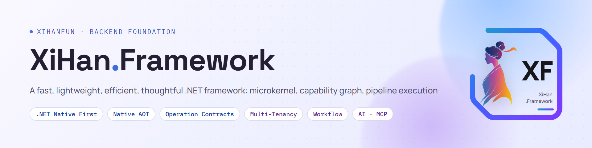

<div align="center">


<h1>XiHan.Framework</h1>

<p><b>A fast, lightweight, efficient and thoughtfully built modern modular framework for .NET</b></p>

<p>Built on .NET · capability-based composition · one operation contract for many protocols · defaults with no external infrastructure</p>

<p><b>English</b> | <a href="./README_cn.md">简体中文</a></p>

<p>
  <a href="https://github.com/XiHanFun/XiHan.Framework/stargazers"></a>
  <a href="https://gitee.com/XiHanFun/XiHan.Framework"></a>
  <a href="https://gitcode.com/XiHanFun/XiHan.Framework"></a>
</p>
<p>
  
  
  <a href="https://www.nuget.org/packages?q=XiHan.Framework"></a>
  <a href="https://www.nuget.org/packages/XiHan.Framework.Kernel"></a>
</p>


<p>
  <a href="./LICENSE"></a>
  <a href="https://github.com/XiHanFun/XiHan.Framework/commits"></a>
  
  <a href="https://github.com/XiHanFun/XiHan.Framework/issues"></a>
  <a href="https://github.com/XiHanFun/XiHan.Framework/graphs/contributors"></a>
  
</p>

<p>
  <a href="https://zread.ai/XiHanFun/XiHan.Framework" target="_blank"></a>
  <a href="https://deepwiki.com/XiHanFun/XiHan.Framework"></a>
  <a href="https://framework.docs.xihanfun.com"></a>
  <a href="https://qm.qq.com/q/qYp1Urv3z2"></a>
</p>
<p>
  <a href="https://trendshift.io/repositories/83128?utm_source=trendshift-badge&amp;utm_medium=badge&amp;utm_campaign=badge-trendshift-83128" target="_blank" rel="noopener noreferrer"></a>
</p>

</div>

## Overview

XiHan.Framework is a modular .NET framework for enterprise applications. Capabilities are split into independent packages by ring, dependencies are declared by capability ID in each feature's manifest, and a business endpoint is a single protocol-agnostic operation contract served over HTTP, gRPC, MCP and the command line. Every abstraction ships with a default implementation that needs no external infrastructure; switching to another provider only changes package references and configuration.

## Documentation

| Destination | Contents |
| --- | --- |
| [Documentation site](https://framework.docs.xihanfun.com) | Full guides and per-package API docs |
| [Framework engineering notes](./framework/README.md) | Package catalog, samples, gates, directory layout |
| [Design documents](./design/框架总体方案.md) | Overall design, architecture notes, ADRs |
| [Specification](https://github.com/XiHanFun/framework-spec) | RFCs, vocabulary, manifest schema, protocol mappings, conformance vectors |
| [Changelog](https://framework.docs.xihanfun.com/changelog) | Release notes and upgrade advisories |
| [Contributing guide](https://docs.xihanfun.com/cosmos/contributing) | Branch conventions, commit rules, local build and test |

## Design Principles

- **Ring dependencies** — primitives → kernel → abstractions → implementations → hosting → protocols and plugins → profiles; dependencies only point downward
- **Capability-based composition** — a feature's manifest declares what it provides and requires, and the capability graph is resolved at startup instead of coupling to package names
- **Protocol-agnostic** — one operation contract serves many protocols through one pipeline and one schema
- **Self-sufficient defaults** — every abstraction has an in-memory or file-system implementation that is bounded and passes the conformance suite
- **Specification first** — public contracts go into an RFC before the code and conformance vectors
- **Failures are values** — recoverable failures return `Result<T>` instead of throwing
- **AOT friendly** — the kernel uses no reflection and source-generated serialization, and the SimpleApp sample publishes as Native AOT; providers that need reflection say so in their package notes

## Tech Stack

| Category | Technology |
| --- | --- |
| Runtime | .NET 10 |
| Language | C# |
| Persistence | In-memory, Entity Framework Core, SqlSugar |
| Caching | In-memory, Redis, two-level cache |
| Messaging | In-memory, RabbitMQ, Kafka, CloudEvents envelope |
| Object storage | File system, S3-compatible services |
| Security | API key, JWT, OpenID Connect, RBAC |
| Configuration | .NET configuration, Nacos |
| Observability | OpenTelemetry |
| AI | Microsoft.Extensions.AI, Microsoft.Extensions.VectorData |
| Protocols | HTTP (OpenAPI 3.1), gRPC, MCP, CloudEvents, command line |
| Plugins | In-process (AssemblyLoadContext), out-of-process (gRPC), Wasm (wasmtime) |
| Testing | xunit.v3 + Microsoft.Testing.Platform |

Exact versions are in `framework/Directory.Packages.props`.

## Getting Started

### Install

```bash
dotnet add package XiHan.Framework.Profiles.Minimal --prerelease
dotnet add package XiHan.Framework.Protocols.Http --prerelease
dotnet add package XiHan.Framework.Kernel.Generators --prerelease
```

To debug the framework source or use a local package source, see the [quickstart](https://framework.docs.xihanfun.com/quickstart).

### Write an operation contract

In the operation ID `greetings.create`, the resource is `greetings` and the verb is `create`, so the HTTP adapter derives `POST /greetings`. The kernel does not serialize through reflection, so request and response types are registered in a source-generated serializer context:

```csharp
[Operation(Id, Stability = Stability.Experimental, Expose = Expose.Http)]
public sealed class Greet : IOperation<GreetRequest, GreetResponse>
{
    public const string Id = "greetings.create";

    public ValueTask<Result<GreetResponse>> HandleAsync(GreetRequest request, InvocationContext context)
        => ValueTask.FromResult(Result.Success(new GreetResponse($"Hello, {request.Name}!", context.TraceId)));
}

public sealed record GreetRequest(string Name);

public sealed record GreetResponse(string Message, string TraceId);

[JsonSourceGenerationOptions(PropertyNamingPolicy = JsonKnownNamingPolicy.CamelCase, PropertyNameCaseInsensitive = true)]
[JsonSerializable(typeof(GreetRequest))]
[JsonSerializable(typeof(GreetResponse))]
internal sealed partial class AppJsonContext : JsonSerializerContext;
```

### Write a feature

The manifest declares that this feature requires the kernel's hosting capability, and `Configure` calls the registration method produced by the source generator:

```csharp
public sealed class GreetingsFeature : IFeature
{
    public Manifest Manifest { get; } = new()
    {
        Id = "xihan.hello.greetings",
        Package = "HelloXiHan",
        Version = "1.0.0",
        Primitives = 1,
        Stability = Stability.Experimental,
        Kind = ManifestKind.Capability,
        Requires = [new CapabilityRequirement(KernelCapabilities.Hosting, KernelCapabilities.Version)],
        Entry = typeof(GreetingsFeature).FullName,
    };

    public void Configure(FeatureContext context) => context.AddGeneratedOperations();
}
```

### Start the application

```csharp
var builder = WebApplication.CreateBuilder(args);

// Hand the features to the kernel: it resolves the capability graph and calls each Configure in topological order
builder.AddXiHan(xihan => xihan
    .UseMinimalProfile()
    .UseFeature<HttpProtocolFeature>()
    .UseFeature<GreetingsFeature>());

var app = builder.Build();

app.UseXiHan();            // HTTP requests enter the kernel pipeline
app.MapXiHanHealth();      // /health/startup, /health/ready, /health/live
app.MapXiHanOperations();  // Map routes from the operation registry

app.Run();
```

### Lifecycle and pipeline

The application starts and stops through a state machine, and a failure at any step moves it to `Failed`:

```text
Declared → Resolved → Configured → Started → Ready → (Degraded) → Draining → Stopped
```

Every invocation goes through the same pipeline of fixed stages:

```text
ingress → observe → resilience → authenticate → tenant → authorize → validate → idempotency → transaction → handle → egress
```

## NuGet Packages

All packages are published to [NuGet.org](https://www.nuget.org/packages?q=XiHan.Framework) under the same name as their project.

| Common package | Purpose |
| --- | --- |
| `XiHan.Framework.Profiles.Minimal` | Profile: primitives + kernel + ASP.NET Core host + in-memory localization |
| `XiHan.Framework.Profiles.Standard` | Profile: Minimal + domain + abstractions and in-memory defaults of five subsystems |
| `XiHan.Framework.Profiles.Full` | Profile: Standard + object storage, scheduling, auditing, workflow, AI tool bridge, OpenTelemetry and four protocol adapters |
| `XiHan.Framework.Protocols.Http` | HTTP protocol adapter: routes derived from operation IDs, OpenAPI |
| `XiHan.Framework.Kernel.Generators` | Source generator: `[Operation]` → registration code and JSON Schema |
| `XiHan.Framework.Persistence.EntityFrameworkCore` | EF Core provider |
| `XiHan.Framework.Persistence.SqlSugar` | SqlSugar provider |
| `XiHan.Framework.Caching.Redis` | Redis provider: shared cache, distributed lock, idempotency |
| `XiHan.Framework.Messaging.RabbitMQ` | RabbitMQ provider |
| `XiHan.Framework.Security.Jwt` | JWT Bearer authentication provider |

The full catalog is in the [framework engineering notes](./framework/README.md#正式包).

## Requirements

| Dependency | Version |
| --- | --- |
| .NET SDK | 10.0+ |
| C# | Latest |
| Platforms | Windows / Linux / macOS |

## Ecosystem

- [XiHan.Framework](https://github.com/XiHanFun/XiHan.Framework) - A fast, lightweight, efficient and thoughtfully built modern modular framework for .NET
- [XiHan.UI](https://github.com/XiHanFun/XiHan.UI) - A fast, lightweight, efficient and thoughtfully built framework-agnostic headless UI component library
- [XiHan.BasicApp](https://github.com/XiHanFun/XiHan.BasicApp) - A beautifully crafted general-purpose admin kernel built on XiHan.Framework and XiHan.UI

## Contributing

Issues and pull requests are welcome — see the [contributing guide](https://docs.xihanfun.com/cosmos/contributing).

## Acknowledgements

In no particular order.

| Project                                    | Thanks for                                        |
| ------------------------------------------ | ------------------------------------------------- |
| [Abp](https://github.com/abpframework/abp) | Inspiring parts of the architecture and design    |
| Other third-party dependencies             | Being the foundation this project is built upon   |


## Support & Sponsorship

If this project helps your work, feel free to buy the author a coffee.

Official sponsorship page: https://docs.xihanfun.com/cosmos/sponsor


## License

Copyright (c) 2021-Present XiHanFun and contributors.

Released under the MIT License — see [License](./LICENSE).

The XiHan.Framework logo and name belong to the author; third-party dependencies and services are governed by their own licenses and terms.

This project is provided for study and reference; the author assumes no liability for any use of the software.
