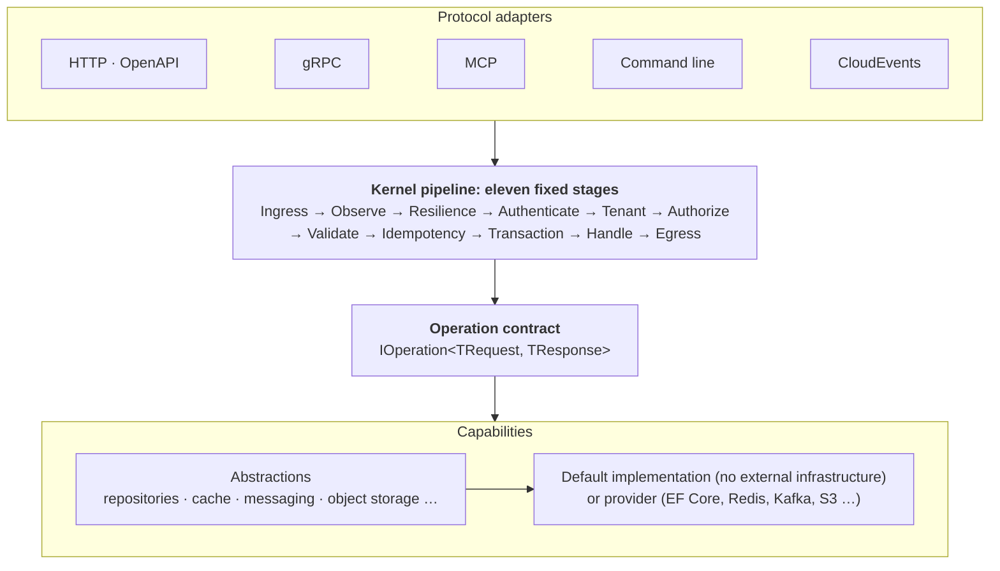

<div align="center">


<h3>One operation contract, served over HTTP, gRPC, MCP and the command line</h3>

<p>
  <a href="https://github.com/XiHanFun/XiHan.Framework/actions/workflows/ci.yml"></a>
  <a href="https://www.nuget.org/packages?q=XiHan.Framework"></a>
  
  <a href="./LICENSE"></a>
  <a href="https://github.com/XiHanFun/XiHan.Framework/stargazers"></a>
  <a href="https://gitee.com/XiHanFun/XiHan.Framework"></a>
  <a href="https://gitcode.com/XiHanFun/XiHan.Framework"></a>
</p>

<p>
  <a href="https://framework.docs.xihanfun.com"><b>Docs</b></a> ·
  <a href="#getting-started"><b>Getting Started</b></a> ·
  <a href="#samples"><b>Samples</b></a> ·
  <a href="https://framework.docs.xihanfun.com/packages/"><b>Packages</b></a> ·
  <a href="https://github.com/XiHanFun/framework-spec"><b>Specification</b></a> ·
  <a href="https://framework.docs.xihanfun.com/changelog"><b>Changelog</b></a>
</p>

<p><b>English</b> | <a href="./README_cn.md">简体中文</a></p>

</div>

XiHan.Framework is a .NET application framework for long-lived systems, built on a microkernel, a capability graph and an execution pipeline. It is also the reference implementation of the language-neutral [XiHan Spec](https://github.com/XiHanFun/framework-spec).

## Features

| Feature | Description |
| --- | --- |
| [Operation contracts](https://framework.docs.xihanfun.com/guide/operations) | Declared once, exposed over many protocols, sharing schema, authorization and error codes |
| [Capability graph](https://framework.docs.xihanfun.com/guide/modularity) | Dependencies declared by capability ID, resolved and validated before startup |
| [Execution pipeline](https://framework.docs.xihanfun.com/guide/pipeline) | Eleven fixed stages for authentication, tenancy, authorization, validation, idempotency and transactions |
| [Replaceable implementations](https://framework.docs.xihanfun.com/packages/) | Defaults with no external dependencies; providers pass the same conformance suite |
| [Native AOT](https://framework.docs.xihanfun.com/guide/aot) | Reflection-free kernel, with registration code and schemas generated at compile time |
| [Plugins](https://framework.docs.xihanfun.com/guide/plugins) | In-process, Wasm and out-of-process isolation, in multiple languages, with failures contained from the host |
| [AI integration](https://framework.docs.xihanfun.com/ai/mcp) | Operations as MCP tools and model tools, plus an offline knowledge base for coding assistants |

## Getting Started

```bash
dotnet add package XiHan.Framework.Profiles.Minimal --prerelease
dotnet add package XiHan.Framework.Protocols.Http --prerelease
dotnet add package XiHan.Framework.Kernel.Generators --prerelease
```

```csharp
[Operation("greetings.create")]
public sealed class Greet : IOperation<GreetRequest, GreetResponse>
{
    public ValueTask<Result<GreetResponse>> HandleAsync(GreetRequest request, InvocationContext context)
        => ValueTask.FromResult(Result.Success(new GreetResponse($"Hello, {request.Name}!")));
}
```

Protocol entry points derive from the contract and take effect once the matching protocol package is added:

| HTTP | gRPC | MCP | Command line |
| --- | --- | --- | --- |
| `POST /greetings` | `Greetings/Create` | `greetings_create` | `greetings create --name Ada` |

The feature manifest, serializer context and application entry point are covered in the [quickstart](https://framework.docs.xihanfun.com/quickstart).

## Architecture



Three tiers of promise, after the I Ching's unchanging (不易), simple (简易) and changing (变易). Dependencies point only to lower rings, enforced by architecture tests. See the [overall design](./plans/框架总体方案.md) (in Chinese).

| Tier | Scope | Promise |
| --- | --- | --- |
| Unchanging | `Primitives` | Never breaks, only grows |
| Simple | `Kernel` | No breaking changes within a major version |
| Changing | Abstractions, implementations, hosts, protocols, plugins, profiles | Evolves independently, with compatibility held by conformance tests |

## Capabilities

| Capability | Default | Providers |
| --- | --- | --- |
| [Persistence](https://framework.docs.xihanfun.com/guide/persistence) | In-memory | EF Core, SqlSugar |
| [Caching and distributed locks](https://framework.docs.xihanfun.com/guide/caching) | In-memory | Redis, two-level cache, remote plugin |
| [Messaging](https://framework.docs.xihanfun.com/guide/messaging) | In-memory, with outbox | RabbitMQ, Kafka, CloudEvents webhook |
| [Multi-tenancy](https://framework.docs.xihanfun.com/guide/multi-tenancy) | In-memory | Database, with per-tenant databases |
| [Authentication](https://framework.docs.xihanfun.com/guide/authentication) and [authorization](https://framework.docs.xihanfun.com/guide/authorization) | In-memory (API key, RBAC) | JWT, OpenID Connect, database |
| [Scheduling](https://framework.docs.xihanfun.com/guide/scheduling) | In-memory | Database (clustered), Kubernetes (leader election) |
| [Workflow](https://framework.docs.xihanfun.com/guide/workflow) | In-memory | Database |
| [Object storage](https://framework.docs.xihanfun.com/guide/storage) | File system | S3 and compatible services |
| [Auditing](https://framework.docs.xihanfun.com/guide/auditing) | In-memory | Database |
| [Localization](https://framework.docs.xihanfun.com/guide/localization) | In-memory (10 locales) | Database |
| [Configuration](https://framework.docs.xihanfun.com/guide/configuration) | .NET configuration | Nacos |
| [Observability](https://framework.docs.xihanfun.com/guide/observability) | `System.Diagnostics` | OpenTelemetry |
| [AI](https://framework.docs.xihanfun.com/guide/ai) | Tool bridge | OpenAI-compatible endpoints, VectorData |

Profiles: `Profiles.Minimal` (kernel and host), `Profiles.Standard` (adds the domain model and five subsystems), `Profiles.Full` (adds the remaining subsystems and four protocol adapters).

## Samples

```bash
git clone --recurse-submodules --branch dev https://github.com/XiHanFun/XiHan.Framework.git
cd XiHan.Framework
dotnet run --project framework/samples/SimpleApp
```

| Sample | Contents |
| --- | --- |
| [SimpleApp](./framework/samples/SimpleApp) | Standard profile: a multi-protocol order service with tenancy, authentication, permissions, transactions and an outbox; the Native AOT smoke test |
| [SimpleCli](./framework/samples/SimpleCli) | Minimal profile: command line and MCP stdio |
| [KubernetesApp](./framework/samples/KubernetesApp) | Full profile: probes, graceful shutdown, configuration hot reload, leader election |
| [Plugin samples](./framework/samples) | In-process, out-of-process (.NET, Go) and Wasm (Rust) |

## Use Cases

- **Suited to**: medium to large backends with long maintenance horizons; multi-tenant SaaS and enterprise admin systems; services exposed over several protocols; third-party plugins in multiple languages.
- **Not suited to**: short-lived CRUD projects; projects that need built-in templating, search or a gateway.

See [Why XiHan](https://framework.docs.xihanfun.com/why) for selection criteria.

## Quality

- **Gates**: warnings as errors; architecture tests and analyzers enforce dependency direction, naming, reflection and third-party type leaks.
- **Public API**: `PublicAPI` baselines, package validation and stability levels.
- **Conformance**: defaults and providers share test suites, run in CI against PostgreSQL, SQL Server, MySQL, Oracle, Redis, RabbitMQ and Qdrant.
- **Decisions**: public contracts begin as RFCs, and major decisions are recorded as [ADRs](./plans/adr/README.md).

## Ecosystem

| Project | Description |
| --- | --- |
| [framework-spec](https://github.com/XiHanFun/framework-spec) | XiHan Spec: RFCs, vocabulary, protocol mappings and conformance vectors |
| [framework-sdk-go](https://github.com/XiHanFun/framework-sdk-go) | Go SDK for out-of-process plugins and remote providers |
| [XiHan.UI](https://github.com/XiHanFun/XiHan.UI) | A fast, lightweight, efficient and thoughtfully built framework-agnostic headless UI component library |
| [XiHan.BasicApp](https://github.com/XiHanFun/XiHan.BasicApp) | A beautifully crafted general-purpose admin kernel built on XiHan.Framework and XiHan.UI, and the framework's reference application |

## Documentation

The documentation site and design documents are written in Chinese.

| Destination | Contents |
| --- | --- |
| [Quickstart](https://framework.docs.xihanfun.com/quickstart) | From installation to the first operation |
| [Guides](https://framework.docs.xihanfun.com/guide/modularity) | Task-oriented docs by capability |
| [Packages](https://framework.docs.xihanfun.com/packages/) | One page per package: capabilities, configuration keys, main types |
| [Design documents](./plans/框架总体方案.md) | Overall design, architecture notes and ADRs |
| [Changelog](https://framework.docs.xihanfun.com/changelog) | Release notes and upgrade advisories |

Connect a coding assistant (`cursor`, `vscode` and `codex` are also supported):

```bash
dnx XiHan.Framework.Cli --yes -- setup --client claude
```

Ask an AI: [Zread](https://zread.ai/XiHanFun/XiHan.Framework) · [DeepWiki](https://deepwiki.com/XiHanFun/XiHan.Framework)

## Contributing

[Issues](https://github.com/XiHanFun/XiHan.Framework/issues) and pull requests are welcome; see the [contributing guide](https://docs.xihanfun.com/cosmos/contributing). Community: QQ group [462371834](https://qm.qq.com/q/qYp1Urv3z2). Support the project: [sponsorship page](https://docs.xihanfun.com/cosmos/sponsor).

## Acknowledgements

| Project | Influence |
| --- | --- |
| [Abp](https://github.com/abpframework/abp) | The project that started it all, and the inspiration for parts of the architecture and design |
| [Linux](https://www.kernel.org) | "Don't break userspace" and netfilter hook points: grow-only primitives and fixed pipeline stages |
| [Go](https://go.dev) | Small interfaces and `context.Context`: entities composed from interfaces, and an invocation context carrying cancellation, deadlines and tracing |
| [Rust](https://www.rust-lang.org) | The `core` / `std` split, private by default and `Result`: host-independent primitives and failures as values |
| [FastAPI](https://github.com/fastapi/fastapi) | Types as the contract: schemas generated from types, producing OpenAPI, `.proto` and MCP tools |
| [OpenTelemetry](https://opentelemetry.io) | Specification, multi-language SDKs and conformance tests: how XiHan Spec is organized |

Other influences are listed in the [overall design](./plans/框架总体方案.md#3-借鉴矩阵) (in Chinese).

## License

[MIT](./LICENSE) © 2021-Present XiHanFun and contributors. The XiHan.Framework logo and name belong to the author.
