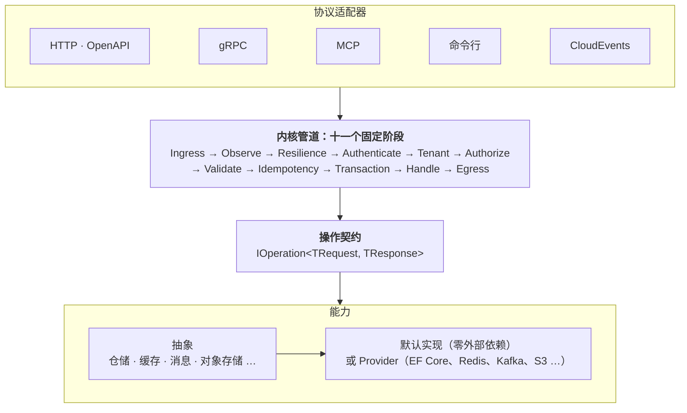

<div align="center">


<h3>一份操作契约，同时服务 HTTP、gRPC、MCP 与命令行</h3>

<p>
  <a href="https://github.com/XiHanFun/XiHan.Framework/actions/workflows/ci.yml"></a>
  <a href="https://www.nuget.org/packages?q=XiHan.Framework"></a>
  
  <a href="./LICENSE"></a>
  <a href="https://github.com/XiHanFun/XiHan.Framework/stargazers"></a>
  <a href="https://gitee.com/XiHanFun/XiHan.Framework"></a>
  <a href="https://gitcode.com/XiHanFun/XiHan.Framework"></a>
</p>

<p>
  <a href="https://framework.docs.xihanfun.com"><b>文档</b></a> ·
  <a href="#快速开始"><b>快速开始</b></a> ·
  <a href="#示例"><b>示例</b></a> ·
  <a href="https://framework.docs.xihanfun.com/packages/"><b>包总览</b></a> ·
  <a href="https://github.com/XiHanFun/framework-spec"><b>规范</b></a> ·
  <a href="https://framework.docs.xihanfun.com/changelog"><b>更新日志</b></a>
</p>

<p><a href="./README.md">English</a> | <b>简体中文</b></p>

</div>

XiHan.Framework 是面向长期演进系统的 .NET 应用框架，以微内核、能力图谱与管道执行为核心，同时是语言中立规范 [XiHan Spec](https://github.com/XiHanFun/framework-spec) 的参考实现。

## 特性

| 特性 | 说明 |
| --- | --- |
| [操作契约](https://framework.docs.xihanfun.com/guide/operations) | 一次声明，多协议暴露，共用 Schema、授权与错误码 |
| [能力图谱](https://framework.docs.xihanfun.com/guide/modularity) | 依赖按能力 ID 声明，启动前完成求解与校验 |
| [执行管道](https://framework.docs.xihanfun.com/guide/pipeline) | 十一个固定阶段承载认证、租户、授权、校验、幂等与事务 |
| [可替换实现](https://framework.docs.xihanfun.com/packages/) | 默认实现零外部依赖，Provider 通过同一套一致性测试 |
| [Native AOT](https://framework.docs.xihanfun.com/guide/aot) | 内核零反射，注册代码与 Schema 于编译期生成 |
| [插件](https://framework.docs.xihanfun.com/guide/plugins) | 进程内、Wasm、进程外三级隔离，支持多语言，故障不影响宿主 |
| [AI 集成](https://framework.docs.xihanfun.com/ai/mcp) | 操作可作为 MCP tool 与模型工具，内置离线知识库服务编码助手 |

## 快速开始

```bash
dotnet add package XiHan.Framework.Profiles.Minimal --prerelease
dotnet add package XiHan.Framework.Protocols.Http --prerelease
dotnet add package XiHan.Framework.Kernel.Generators --prerelease
```

```csharp
[Operation("greetings.create")]
public sealed class Greet : IOperation<GreetRequest, GreetResponse>
{
    public ValueTask<Result<GreetResponse>> HandleAsync(GreetRequest request, InvocationContext context)
        => ValueTask.FromResult(Result.Success(new GreetResponse($"Hello, {request.Name}!")));
}
```

该操作的协议入口由契约推导，加入相应协议包后生效：

| HTTP | gRPC | MCP | 命令行 |
| --- | --- | --- | --- |
| `POST /greetings` | `Greetings/Create` | `greetings_create` | `greetings create --name Ada` |

特性清单、序列化上下文与应用入口见[快速上手](https://framework.docs.xihanfun.com/quickstart)。

## 架构



依《易》之不易、简易、变易分为三层承诺，依赖仅可指向更低的环，由架构测试强制。详见[框架总体方案](./design/框架总体方案.md)。

| 层 | 范围 | 承诺 |
| --- | --- | --- |
| 不易 | `Primitives` | 永不破坏，只增不改 |
| 简易 | `Kernel` | 大版本内不破坏 |
| 变易 | 抽象、实现、宿主、协议、插件、组合包 | 独立演进，以一致性测试保证兼容 |

## 能力

| 能力 | 默认实现 | Provider |
| --- | --- | --- |
| [持久化](https://framework.docs.xihanfun.com/guide/persistence) | 内存 | EF Core、SqlSugar |
| [缓存与分布式锁](https://framework.docs.xihanfun.com/guide/caching) | 内存 | Redis、两级缓存、远程插件 |
| [消息](https://framework.docs.xihanfun.com/guide/messaging) | 内存（含发件箱） | RabbitMQ、Kafka、CloudEvents Webhook |
| [多租户](https://framework.docs.xihanfun.com/guide/multi-tenancy) | 内存 | 数据库（支持分库） |
| [认证](https://framework.docs.xihanfun.com/guide/authentication)与[授权](https://framework.docs.xihanfun.com/guide/authorization) | 内存（API Key、RBAC） | JWT、OpenID Connect、数据库 |
| [调度](https://framework.docs.xihanfun.com/guide/scheduling) | 内存 | 数据库（集群）、Kubernetes（选主） |
| [工作流](https://framework.docs.xihanfun.com/guide/workflow) | 内存 | 数据库 |
| [对象存储](https://framework.docs.xihanfun.com/guide/storage) | 文件系统 | S3 及兼容服务 |
| [审计](https://framework.docs.xihanfun.com/guide/auditing) | 内存 | 数据库 |
| [国际化](https://framework.docs.xihanfun.com/guide/localization) | 内存（10 种区域） | 数据库 |
| [配置](https://framework.docs.xihanfun.com/guide/configuration) | .NET 配置 | Nacos |
| [可观测性](https://framework.docs.xihanfun.com/guide/observability) | `System.Diagnostics` | OpenTelemetry |
| [AI](https://framework.docs.xihanfun.com/guide/ai) | 工具桥 | OpenAI 兼容端点、VectorData |

组合包：`Profiles.Minimal`（内核与宿主）、`Profiles.Standard`（增加领域模型与五个子系统）、`Profiles.Full`（增加其余子系统与四种协议适配器）。

## 示例

```bash
git clone --recurse-submodules --branch dev https://github.com/XiHanFun/XiHan.Framework.git
cd XiHan.Framework
dotnet run --project framework/samples/SimpleApp
```

| 示例 | 内容 |
| --- | --- |
| [SimpleApp](./framework/samples/SimpleApp) | Standard 组合：多协议订单服务，含租户、认证、权限、事务与发件箱；Native AOT 冒烟项目 |
| [SimpleCli](./framework/samples/SimpleCli) | Minimal 组合：命令行与 MCP stdio |
| [KubernetesApp](./framework/samples/KubernetesApp) | Full 组合：探针、优雅停机、配置热更新、领导选举 |
| [插件示例](./framework/samples) | 进程内、进程外（.NET、Go）与 Wasm（Rust） |

## 适用场景

- **适用**：长期维护的中大型后端；多租户 SaaS 与企业中后台；同一业务需多协议服务；需第三方多语言插件。
- **不适用**：短期 CRUD 项目；需模板引擎、搜索、网关等内置能力的项目。

选型依据见[为什么选择曦寒](https://framework.docs.xihanfun.com/why)。

## 质量保障

- **门禁**：警告即错误；架构测试与分析器约束依赖方向、命名、反射与第三方类型泄漏。
- **公开 API**：`PublicAPI` 基线、包验证与稳定性分级。
- **一致性**：默认实现与 Provider 共用测试套件，CI 连接 PostgreSQL、SQL Server、MySQL、Oracle、Redis、RabbitMQ 与 Qdrant 运行。
- **决策**：公开契约先入 RFC，重要决策记入 [ADR](./design/adr/README.md)。

## 路线

Wasm 插件转正、TypeScript SDK、实时通信与网关包、MongoDB 与 NATS 等 Provider。详见[开发计划](./design/architecture/05-开发计划.md)。

## 生态

| 项目 | 说明 |
| --- | --- |
| [framework-spec](https://github.com/XiHanFun/framework-spec) | XiHan Spec：RFC、术语表、协议映射与一致性向量 |
| [framework-sdk-go](https://github.com/XiHanFun/framework-sdk-go) | Go SDK：进程外插件与远程 Provider |
| [XiHan.UI](https://github.com/XiHanFun/XiHan.UI) | 快速、轻量、高效、用心的框架无关 Headless UI 组件库 |
| [XiHan.BasicApp](https://github.com/XiHanFun/XiHan.BasicApp) | 基于 XiHan.Framework 和 XiHan.UI 的超高颜值通用中后台内核，亦为框架的参考应用 |

## 文档

| 去处 | 内容 |
| --- | --- |
| [快速上手](https://framework.docs.xihanfun.com/quickstart) | 从安装到首个操作 |
| [开发指南](https://framework.docs.xihanfun.com/guide/modularity) | 按能力域组织的任务式文档 |
| [包总览](https://framework.docs.xihanfun.com/packages/) | 每包一页：能力、配置键、主要类型 |
| [设计文档](./design/框架总体方案.md) | 总体方案、架构说明与 ADR |
| [更新日志](https://framework.docs.xihanfun.com/changelog) | 版本变更与升级须知 |

接入编码助手（亦支持 `cursor`、`vscode`、`codex`）：

```bash
dnx XiHan.Framework.Cli --yes -- setup --client claude
```

AI 问答：[Zread](https://zread.ai/XiHanFun/XiHan.Framework) · [DeepWiki](https://deepwiki.com/XiHanFun/XiHan.Framework)

## 参与

欢迎提交 [Issue](https://github.com/XiHanFun/XiHan.Framework/issues) 与 Pull Request，规范见[贡献指南](https://docs.xihanfun.com/cosmos/contributing)。交流：QQ 群 [462371834](https://qm.qq.com/q/qYp1Urv3z2)。支持项目：[赞助页](https://docs.xihanfun.com/cosmos/sponsor)。

## 致谢

| 项目 | 借鉴 |
| --- | --- |
| [Abp](https://github.com/abpframework/abp) | 启蒙项目，部分架构与逻辑的灵感来源 |
| [Linux](https://www.kernel.org) | 「不破坏用户态」与 netfilter 钩子点：原语层只增不改，管道阶段固定 |
| [Go](https://go.dev) | 小接口组合与 `context.Context`：实体按接口组合，调用上下文传播取消、截止时间与追踪 |
| [Rust](https://www.rust-lang.org) | `core` / `std` 分层、默认私有与 `Result`：原语层独立于宿主，失败以值表达 |
| [FastAPI](https://github.com/fastapi/fastapi) | 类型即契约：由类型生成 Schema，进而产出 OpenAPI、`.proto` 与 MCP tool |
| [OpenTelemetry](https://opentelemetry.io) | 规范、多语言 SDK 与一致性测试：XiHan Spec 的组织方式 |

其余借鉴见[框架总体方案](./design/框架总体方案.md#3-借鉴矩阵)。

## 许可证

[MIT](./LICENSE) © 2021-Present XiHanFun and contributors。XiHan.Framework 的 Logo 与名称归作者所有。
