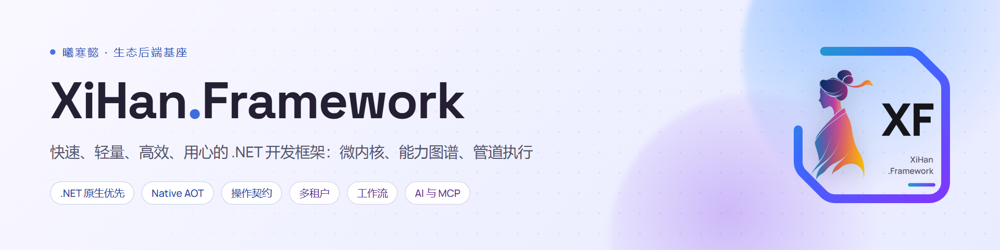
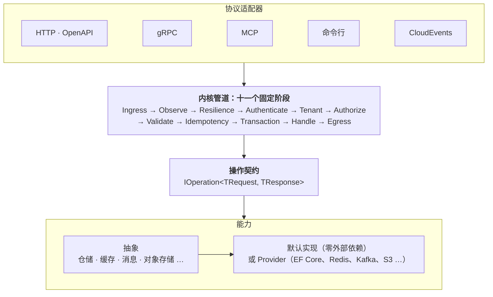

<div align="center">



<h3>一份操作契约，同时服务 HTTP、gRPC、MCP 与命令行</h3>

<p>能力按需装配 · 默认实现零外部依赖 · 内核零反射、可发布 Native AOT · 插件可用任意语言编写</p>

<p>
  <a href="https://github.com/XiHanFun/XiHan.Framework/actions/workflows/ci.yml"></a>
  <a href="https://www.nuget.org/packages?q=XiHan.Framework"></a>
  
  <a href="./LICENSE"></a>
  <a href="https://github.com/XiHanFun/XiHan.Framework/stargazers"></a>
  <a href="https://gitee.com/XiHanFun/XiHan.Framework"></a>
  <a href="https://gitcode.com/XiHanFun/XiHan.Framework"></a>
</p>

<p>
  <a href="https://framework.docs.xihanfun.com"><b>文档</b></a> ·
  <a href="#快速开始"><b>快速开始</b></a> ·
  <a href="#示例"><b>示例</b></a> ·
  <a href="https://framework.docs.xihanfun.com/packages/"><b>包总览</b></a> ·
  <a href="https://github.com/XiHanFun/framework-spec"><b>规范</b></a> ·
  <a href="https://framework.docs.xihanfun.com/changelog"><b>更新日志</b></a>
</p>

<p><a href="./README.md">English</a> | <b>简体中文</b></p>

</div>

XiHan.Framework 是为长期维护的 .NET 后端设计的开发框架，核心是微内核、能力图谱和管道执行。业务写成与协议无关的操作，协议适配器负责把它暴露出去，每次调用都走同一条管道；持久化、缓存、消息、租户和权限都是可替换的包，开发时不需要任何外部设施，上线时换 Provider，业务代码不动。

它同时是语言中立规范 [XiHan Spec](https://github.com/XiHanFun/framework-spec) 的 .NET 参考实现，其他语言按同一份规范和一致性向量实现。

## 一份契约，多种协议

业务只写一次。下面的操作节选自 [SimpleApp](./framework/samples/SimpleApp/Orders/CreateOrder.cs)，声明了要暴露的协议和需要的权限：

```csharp
[Operation("orders.create", Stability = Stability.Experimental,
    Expose = Expose.Http | Expose.Grpc | Expose.Mcp, Permission = "orders.write")]
public sealed class CreateOrder(IRepository<Order, Guid> orders, IIdGenerator<Guid> ids, TimeProvider clock)
    : IOperation<PlaceOrderRequest, OrderResponse>
{
    public async ValueTask<Result<OrderResponse>> HandleAsync(PlaceOrderRequest request, InvocationContext context)
    {
        var order = new Order { Id = ids.NewId(), Name = request.Name, Amount = request.Amount };
        order.Place(clock.GetUtcNow());

        var added = await orders.AddAsync(order, context.CancellationToken);
        return added.IsFailure ? added.Error! : new OrderResponse(order.Id, order.Name, order.Amount, order.CreatedAt);
    }
}
```

源生成器据此产出登记代码和 JSON Schema，各协议的入口都由这一份契约推出：

| 协议 | 入口 | 随之得到 |
| --- | --- | --- |
| HTTP | `POST /orders` | OpenAPI 3.1（`/openapi.json`）、RFC 9457 Problem Details |
| gRPC | `Orders/Create` | `.proto`（`/operations.proto`），protobuf 线格式由 Schema 推出 |
| MCP | tool `orders_create` | `tools/list` 的描述与入参 Schema，支持 Streamable HTTP 和 stdio |
| 命令行 | `greetings create --name Ada`（[SimpleCli](./framework/samples/SimpleCli)） | 按错误种类区分的退出码，失败时 Problem JSON 写到 stderr |
| AI 工具 | `Expose.Ai` | 经完整管道执行的模型工具 |

认证、租户、授权、校验、幂等和事务都在管道里，不会因为换了协议而漏掉。同一个没有 `orders.write` 权限的主体，从 HTTP 和 MCP 进来得到同一个错误码：

```text
$ curl -i -X POST localhost:5000/orders -H "Authorization: ApiKey dev-bob-key" \
    -H "Content-Type: application/json" -d '{"name":"x","amount":1}'
HTTP/1.1 403 Forbidden
{"type":"urn:xihan:error:SECURITY_DENIED_004","status":403,"detail":"Permission 'orders.write' is missing.",…}

$ curl -X POST localhost:5000/mcp -H "Authorization: ApiKey dev-bob-key" -H "Content-Type: application/json" \
    -d '{"jsonrpc":"2.0","id":2,"method":"tools/call","params":{"name":"orders_create","arguments":{"name":"x","amount":1}}}'
{"jsonrpc":"2.0","id":2,"result":{"content":[{"type":"text","text":"SECURITY_DENIED_004: Permission 'orders.write' is missing."}],"isError":true}}
```

## 特性

- **启动前发现装配问题**：每个特性带一份清单，按能力 ID 声明提供和依赖什么。内核在启动前求解能力图谱，缺失、循环、版本冲突、同一能力多个候选都会直接报错，例如 `'xihan.hello.greetings' requires 'caching.distributed@1', but no manifest provides it.`，并在日志里打印解析结果。[能力包与清单](https://framework.docs.xihanfun.com/guide/modularity)
- **横切逻辑有固定位置**：每次调用经过十一个固定阶段，中间件只关心自己的阶段，顺序确定、可打印、可单独测试，不用动态代理。[执行管道](https://framework.docs.xihanfun.com/guide/pipeline)
- **开发零依赖，上线换 Provider**：每个抽象都配一个容量有界的默认实现，不需要数据库或 Redis 就能跑起来。上线时加一个包和一行 `UseFeature`，默认实现自动让位；Provider 与默认实现通过同一套一致性套件。[包总览](https://framework.docs.xihanfun.com/packages/)
- **零反射，可发布 Native AOT**：原语层与内核不用运行时反射，注册和 Schema 在编译期生成，CI 每次都做 AOT 发布冒烟；不支持 AOT 的 Provider 在包页注明。[序列化与 Native AOT](https://framework.docs.xihanfun.com/guide/aot)
- **插件可以不被信任**：进程内、Wasm、进程外三级隔离。进程外插件走 gRPC 协议，可以用任意语言编写（已有 Go SDK），崩溃只让应用降级并退避重启，不会拖垮宿主。[插件](https://framework.docs.xihanfun.com/guide/plugins)
- **为 AI 工具而设计**：操作可以直接成为 MCP tool 和模型工具；`xihan mcp` 把框架的包、配置键和文档作为离线知识库提供给编码助手。[MCP Server](https://framework.docs.xihanfun.com/ai/mcp)
- **边界由机器执行**：依赖方向、命名文法、零反射、第三方类型泄漏和公开 API 基线都由分析器与架构测试把关，不靠代码评审记忆。见[质量与稳定性](#质量与稳定性)。

## 快速开始

需要 [.NET 10 SDK](https://dotnet.microsoft.com/download)。创建项目并加入三个包：

```bash
dotnet new web -n HelloXiHan
cd HelloXiHan
dotnet add package XiHan.Framework.Profiles.Minimal --prerelease
dotnet add package XiHan.Framework.Protocols.Http --prerelease
dotnet add package XiHan.Framework.Kernel.Generators --prerelease
```

把 `Program.cs` 换成下面的内容，一个入口、一个操作、一个特性都在这里：

```csharp
using System.Text.Json.Serialization;
using HelloXiHan; // 源生成器产出的 AddGeneratedOperations 在项目的根命名空间下
using XiHan.Framework.Hosting.AspNetCore;
using XiHan.Framework.Kernel;
using XiHan.Framework.Kernel.Hosting;
using XiHan.Framework.Kernel.Operations;
using XiHan.Framework.Primitives;
using XiHan.Framework.Primitives.Manifests;
using XiHan.Framework.Profiles.Minimal;
using XiHan.Framework.Protocols.Http;
using XiHan.Framework.Protocols.Http.Routing;

var builder = WebApplication.CreateBuilder(args);

// 把特性交给内核：求解能力图谱，按拓扑顺序调用各特性的 Configure
builder.AddXiHan(xihan => xihan
    .UseMinimalProfile()
    .UseFeature<HttpProtocolFeature>()
    .UseFeature<GreetingsFeature>());

var app = builder.Build();

app.UseXiHan();            // HTTP 请求进入内核管道
app.MapXiHanHealth();      // /health/startup、/health/ready、/health/live
app.MapXiHanOperations();  // 按操作登记表映射路由

app.Run();

// 操作：greetings.create 的资源是 greetings、动词是 create，HTTP 上推出 POST /greetings
[Operation("greetings.create", Stability = Stability.Experimental, Expose = Expose.Http)]
public sealed class Greet : IOperation<GreetRequest, GreetResponse>
{
    public ValueTask<Result<GreetResponse>> HandleAsync(GreetRequest request, InvocationContext context)
        => ValueTask.FromResult(Result.Success(new GreetResponse($"Hello, {request.Name}!")));
}

public sealed record GreetRequest(string Name);

public sealed record GreetResponse(string Message);

// 内核不经反射序列化，请求与响应类型登记到源生成的上下文
[JsonSourceGenerationOptions(
    PropertyNamingPolicy = JsonKnownNamingPolicy.CamelCase,
    PropertyNameCaseInsensitive = true)]
[JsonSerializable(typeof(GreetRequest))]
[JsonSerializable(typeof(GreetResponse))]
internal sealed partial class AppJsonContext : JsonSerializerContext;

// 特性：清单声明依赖内核的宿主能力，Configure 登记生成的操作
public sealed class GreetingsFeature : IFeature
{
    public Manifest Manifest { get; } = new()
    {
        Id = "xihan.hello.greetings",
        Package = "HelloXiHan",
        Version = "1.0.0",
        Primitives = 1,
        Stability = Stability.Experimental,
        Kind = ManifestKind.Capability,
        Requires = [new CapabilityRequirement(KernelCapabilities.Hosting, KernelCapabilities.Version)],
        Entry = typeof(GreetingsFeature).FullName,
    };

    public void Configure(FeatureContext context) => context.AddGeneratedOperations();
}
```

运行并调用：

```bash
dotnet run --urls http://localhost:5000
```

```bash
curl -X POST http://localhost:5000/greetings -H "Content-Type: application/json" -d '{"name":"Ada"}'
```

```json
{"message":"Hello, Ada!"}
```

<details>
<summary>启动日志会打印能力图谱和管道顺序</summary>

```text
Capability graph:
xihan.kernel.core <版本>
  provides kernel.hosting@1
  ...
xihan.localization.inmemory <版本> (default)
  provides localization.resources@1
  requires kernel.hosting@1 -> xihan.kernel.core
xihan.protocols.http <版本>
  provides protocols.http@1
  requires kernel.hosting@1 -> xihan.kernel.core
xihan.hello.greetings 1.0.0
  requires kernel.hosting@1 -> xihan.kernel.core

Pipeline:
observe      XiHan.Framework.Kernel.Diagnostics.ObserveMiddleware
resilience   XiHan.Framework.Kernel.Pipeline.DeadlineMiddleware
resilience   XiHan.Framework.Kernel.Resilience.ResilienceMiddleware
validate     XiHan.Framework.Kernel.Validation.ValidationMiddleware
```

</details>

<details>
<summary>请求不合契约时，返回按 Accept-Language 翻译的 Problem Details</summary>

```bash
curl -i -X POST http://localhost:5000/greetings -H "Content-Type: application/json" -H "Accept-Language: zh-CN" -d '{}'
```

```text
HTTP/1.1 400 Bad Request
Content-Type: application/problem+json
Content-Language: zh-CN

{"type":"urn:xihan:error:KERNEL_VALIDATION_003","title":"VALIDATION","status":400,
 "detail":"操作 'greetings.create' 的请求不符合契约：$.name: required property 'name' is missing",
 "instance":"/greetings","code":"KERNEL_VALIDATION_003","traceId":"…",
 "errors":{"name":["缺少必填属性 'name'"]},
 "details":{"id":"greetings.create","reason":"$.name: required property 'name' is missing"}}
```

</details>

接下来可以读[快速上手](https://framework.docs.xihanfun.com/quickstart)，把组合换成 Standard，看管道里多出认证、租户、授权、幂等和事务。

## 架构



框架按三层承诺组织，取自《易》的不易、简易、变易：只冻结极小的一层，其余都可以替换。依赖只能指向更低的环，由架构测试强制执行。

| 承诺 | 环 | 内容 |
| --- | --- | --- |
| **不易**：永不破坏，只增不改 | Ring 0 | `Primitives`：`Result`、`Error`、调用上下文、清单模型、管道阶段 |
| **简易**：大版本内不破坏 | Ring 1 | `Kernel`：宿主、能力图谱、管道、操作契约、诊断、安全原语 |
| **变易**：各自演进，通过一致性套件即视为兼容 | Ring 2–6 | 抽象、默认实现与 Provider、宿主、协议与插件、组合包 |

设计依据见[框架总体方案](./design/框架总体方案.md)和[设计哲学](./design/architecture/02-框架设计哲学.md)。

## 开箱能力

| 能力 | 默认实现（零外部依赖） | Provider |
| --- | --- | --- |
| [持久化](https://framework.docs.xihanfun.com/guide/persistence) | 内存 | EF Core、SqlSugar |
| [缓存与分布式锁](https://framework.docs.xihanfun.com/guide/caching) | 内存 | Redis、两级缓存、远程插件 |
| [消息与事件](https://framework.docs.xihanfun.com/guide/messaging) | 内存，带发件箱 | RabbitMQ、Kafka、CloudEvents Webhook |
| [多租户](https://framework.docs.xihanfun.com/guide/multi-tenancy) | 内存 | 数据库（支持租户分库） |
| [认证](https://framework.docs.xihanfun.com/guide/authentication)与[授权](https://framework.docs.xihanfun.com/guide/authorization) | 内存（API Key、RBAC） | JWT、OpenID Connect、数据库授权 |
| [调度](https://framework.docs.xihanfun.com/guide/scheduling) | 内存 | 数据库（集群分发）、Kubernetes（领导选举） |
| [工作流](https://framework.docs.xihanfun.com/guide/workflow) | 内存 | 数据库 |
| [对象存储](https://framework.docs.xihanfun.com/guide/storage) | 文件系统 | S3 与兼容服务（MinIO、OSS、COS、R2） |
| [审计](https://framework.docs.xihanfun.com/guide/auditing) | 内存 | 数据库 |
| [国际化](https://framework.docs.xihanfun.com/guide/localization) | 内存（内置 10 种区域） | 数据库 |
| [配置](https://framework.docs.xihanfun.com/guide/configuration) | .NET 配置 | Nacos |
| [可观测性](https://framework.docs.xihanfun.com/guide/observability) | `System.Diagnostics` | OpenTelemetry |
| [AI](https://framework.docs.xihanfun.com/guide/ai) | 工具桥（`Expose.Ai`） | OpenAI 兼容端点、`Microsoft.Extensions.VectorData` |

不想逐个挑包时，用组合包：

| 组合包 | 内容 | 适合 |
| --- | --- | --- |
| `XiHan.Framework.Profiles.Minimal` | 原语层、内核、ASP.NET Core 宿主、内存本地化 | 边缘服务、工具、插件宿主 |
| `XiHan.Framework.Profiles.Standard` | Minimal，加领域模型和五个子系统的抽象与默认实现 | 大多数业务服务 |
| `XiHan.Framework.Profiles.Full` | Standard，加对象存储、调度、审计、工作流、AI 工具桥、OpenTelemetry 和四种协议适配器 | 中后台、SaaS |

全部包见[包总览](https://framework.docs.xihanfun.com/packages/)或[框架工程说明](./framework/README.md#正式包)。

## 示例

都不需要外部设施，克隆后就能运行：

```bash
git clone --recurse-submodules --branch dev https://github.com/XiHanFun/XiHan.Framework.git
cd XiHan.Framework
dotnet run --project framework/samples/SimpleApp
```

```bash
curl -X POST localhost:5000/orders -H "Authorization: ApiKey dev-alice-key" \
  -H "Content-Type: application/json" -d '{"name":"widget","amount":3}'
```

| 示例 | 内容 |
| --- | --- |
| [SimpleApp](./framework/samples/SimpleApp) | Standard 组合：同一份订单契约同时经 HTTP、gRPC、MCP 暴露，入站 CloudEvents 交给消息处理器，带租户、API Key 认证、权限、事务、领域事件和发件箱；同时是 Native AOT 冒烟项目 |
| [SimpleCli](./framework/samples/SimpleCli) | Minimal 组合：同一份契约作为命令行命令和 MCP stdio tool |
| [KubernetesApp](./framework/samples/KubernetesApp) | Full 组合：探针、优雅停机、ConfigMap 热更新、Lease 领导选举和 `xihan pack` 生成的部署产物 |
| [插件示例](./framework/samples) | `SamplePlugin`（进程内）、`EchoPlugin`（进程外 .NET）、`EchoWasmPlugin`（Rust 写的 Wasm）、`EchoGoPlugin`、`CacheGoPlugin`（Go 写的进程外插件与远程 Provider） |

## 适合什么项目

**适合：**

- 中大型、长期维护、多人协作的后端，重视依赖边界和可替换性
- 多租户 SaaS、企业中后台，需要租户、权限、审计、工作流、调度
- 同一业务要同时提供 REST、gRPC、MCP tool 或命令行
- 需要第三方用其他语言写插件，或者要求插件崩溃不拖垮宿主

**不太适合：**

- 短期项目，只要几个 CRUD 接口：直接用 ASP.NET Core 最小 API 更省事
- 团队不想写清单、不接受 `Result` 风格：这套写法更显式，概念也更多
- 想要模板引擎、搜索、网关、对象映射这类全家桶：框架不提供，替代做法见[常见问题](https://framework.docs.xihanfun.com/guide/faq)

代价和限制都写在[为什么选择曦寒](https://framework.docs.xihanfun.com/why)里。

## 质量与稳定性

- **边界进门禁**：警告即错误；依赖方向、包 ID 文法、命名空间、零反射、第三方类型泄漏和 XML 文档由架构测试与 Roslyn 分析器执行。
- **公开 API 有基线**：每个包有 `PublicAPI` 文件和包验证，公开类型标注 `Stable`、`Preview`、`Experimental`、`Internal` 或 `Deprecated`。
- **Provider 有一致性套件**：各子系统都有一套套件，默认实现和 Provider 跑同样的用例。CI 连着真实的 PostgreSQL、SQL Server、MySQL、Oracle、Redis、RabbitMQ 和 Qdrant 运行，全仓共 1600 多个测试方法。
- **规范先于实现**：公开契约先进 RFC，再写代码和一致性向量。目前有 23 份 [RFC](https://github.com/XiHanFun/framework-spec/tree/main/rfcs)、120 多份 [ADR](./design/adr/README.md)，每个重要决定都能查到理由。
- **真实应用检验**：[XiHan.BasicApp](https://github.com/XiHanFun/XiHan.BasicApp) 是框架的参考应用，框架的许多能力和修复来自它的接入反馈。

## 路线

接下来的方向包括 Wasm 插件转正、TypeScript SDK、实时通信与网关包，以及 MongoDB、NATS 等更多 Provider，详见[开发计划](./design/architecture/05-开发计划.md)。

## 生态

| 项目 | 说明 |
| --- | --- |
| [framework-spec](https://github.com/XiHanFun/framework-spec) | XiHan Spec：RFC、术语表、清单 Schema、协议映射、一致性向量和黑盒运行器 |
| [framework-sdk-go](https://github.com/XiHanFun/framework-sdk-go) | Go SDK：编写进程外插件和远程 Provider |
| [XiHan.UI](https://github.com/XiHanFun/XiHan.UI) | 快速、轻量、高效、用心的框架无关 Headless UI 组件库 |
| [XiHan.BasicApp](https://github.com/XiHanFun/XiHan.BasicApp) | 基于 XiHan.Framework 和 XiHan.UI 的超高颜值通用中后台内核 |

## 文档

| 去处 | 内容 |
| --- | --- |
| [快速上手](https://framework.docs.xihanfun.com/quickstart) | 从安装到写出第一个操作，再到换成 Standard 组合 |
| [开发指南](https://framework.docs.xihanfun.com/guide/modularity) | 按能力域组织的任务式文档 |
| [包总览](https://framework.docs.xihanfun.com/packages/) | 每包一页：提供的能力、配置键、主要类型、限制 |
| [设计文档](./design/框架总体方案.md) | 总体方案、架构说明、开发计划和 ADR |
| [框架工程说明](./framework/README.md) | 包清单、示例命令、门禁和目录结构 |
| [更新日志](https://framework.docs.xihanfun.com/changelog) | 各版本变更与升级须知 |

用编码助手开发时，在项目根运行下面的命令，把框架的离线知识库接成 MCP 服务（也支持 `cursor`、`vscode`、`codex`）：

```bash
dnx XiHan.Framework.Cli --yes -- setup --client claude
```

也可以直接向 AI 提问：[Zread](https://zread.ai/XiHanFun/XiHan.Framework) · [DeepWiki](https://deepwiki.com/XiHanFun/XiHan.Framework)。

## 参与贡献

欢迎提交 [Issue](https://github.com/XiHanFun/XiHan.Framework/issues) 和 Pull Request，分支约定、提交规范和本地构建见[贡献指南](https://docs.xihanfun.com/cosmos/contributing)。也可以加入 QQ 群 [462371834](https://qm.qq.com/q/qYp1Urv3z2) 交流。

## 致谢

| 项目 | 致谢 |
| --- | --- |
| [Abp](https://github.com/abpframework/abp) | 启蒙项目，部分架构和逻辑的灵感来源；它在多租户、审计、权限上的完整度是子系统能力的对照表 |
| [Linux](https://www.kernel.org) | 「不破坏用户态」的承诺和 netfilter 钩子点，对应只增不改的原语层和管道的固定阶段 |
| [Go](https://go.dev) | 小接口组合和 `context.Context`，对应按接口组合的实体和带取消、截止时间、追踪的调用上下文 |
| [Rust](https://www.rust-lang.org) | `core` / `std` 分层、默认私有和 `Result`，对应不依赖宿主的原语层、默认 `internal` 和「失败是值」 |
| [FastAPI](https://github.com/fastapi/fastapi) | 类型即契约，对应由类型生成 Schema，再产出 OpenAPI、`.proto` 和 MCP tool 的操作契约 |
| [OpenTelemetry](https://opentelemetry.io) | 规范、各语言 SDK 加一致性测试的组织方式，对应 XiHan Spec 和一致性向量 |

更多借鉴见[框架总体方案](./design/框架总体方案.md#3-借鉴矩阵)。第三方依赖是项目功能丰富与拓展的基石，一并感谢。

## 赞助

如果这个项目对你有帮助，欢迎请作者喝杯咖啡：[赞助页](https://docs.xihanfun.com/cosmos/sponsor)。

## 许可证

Copyright (c) 2021-Present XiHanFun and contributors.

本项目采用 [MIT](./LICENSE) 许可证。XiHan.Framework 的 Logo 和名称归作者所有，第三方依赖和第三方服务分别遵循其各自的许可与服务条款。
